# HotelTech — Sistema de gestión hotelera

**Universidad Santo Tomás — Seccional Tunja**  
Ingeniería de Sistemas | Desarrollo Orientado a Servicios | 2026-2

**Integrantes:** 
José Alirio Camargo Patarroyo
Juan Diego Matallana Castellanos
Cristian Rene Chaves Tamayo
Juan Pablo Sierra Zorro

**Video de sustentación:** 
https://www.youtube.com/watch?v=Zlbtgxh0lZ8

## 1. Descripción del proyecto

HotelTech es una aplicación de gestión hotelera orientada a pequeños y medianos hoteles que necesitan centralizar el registro de huéspedes, habitaciones y reservas. Busca reducir los errores asociados al manejo manual de la información, facilitar la consulta de disponibilidad y evitar conflictos entre reservas.

El sistema está dirigido a administradores y recepcionistas. Permite gestionar la información desde una interfaz web y una API REST que comparten las mismas reglas de negocio mediante una arquitectura hexagonal.

### Funcionalidades principales

- Inicio de sesión con roles de administrador y recepcionista.
- Registro y consulta de habitaciones, disponibilidad por fechas y cambios de estado operativo.
- Registro y consulta de huéspedes.
- Creación y listado de reservas, cancelación, check-in y check-out.
- Cálculo del valor de la estadía a partir de las noches y la tarifa registrada al reservar.
- Generación de reportes de reservas por fechas y comprobantes de salida en PDF.
- Persistencia local mediante JDBI y SQLite.
- Validaciones de dominio, mensajes de error y páginas 404 y 500.

## 2. Pasos para correr el proyecto

### Requisitos previos

- JDK 21.
- IntelliJ IDEA (recomendado).
- Conexión a Internet para la primera descarga de Gradle y las dependencias.
- Puerto 8080 y 7070 disponibles.
- Postman (opcional, para probar la API REST).

No se necesita instalar Gradle manualmente, Node.js, Docker ni un servidor de base de datos. El proyecto incluye Gradle Wrapper, configurado con la versión 9.6.0.

### 2.1. Abrir y configurar el proyecto

1. Descomprimir el archivo del proyecto.
2. Abrir en IntelliJ IDEA la carpeta `hoteltech`, donde se encuentra `build.gradle.kts`.
3. En **File > Project Structure > Project**, seleccionar JDK 21.
4. En **Settings > Build, Execution, Deployment > Build Tools > Gradle**, seleccionar Java 21 como Gradle JVM y utilizar el Wrapper del proyecto.
5. Sincronizar el proyecto Gradle.

### 2.2. Configurar la base de datos

Se utiliza SQLite a través de JDBI. El archivo `hoteltech.db` se encuentra o se crea en el directorio de trabajo. La clase `Application.java` configura JDBI y ejecuta automáticamente `schema.sql` y `data.sql` para inicializar las tablas y los datos de prueba.

El archivo `src/main/resources/application.properties` contiene:

```properties
spring.application.name=hoteltech
server.port=8080
spring.datasource.url=jdbc:sqlite:hoteltech.db
spring.datasource.driver-class-name=org.sqlite.JDBC
spring.sql.init.mode=always
spring.thymeleaf.cache=false
```

La conexión efectiva de JDBI se define en `Application.java` como `jdbc:sqlite:hoteltech.db?date_string_format=yyyy-MM-dd`. Si se cambia la ubicación de la base de datos, se debe revisar esa configuración también. El puerto REST se define en esa misma clase mediante `restApi.start(7070)`.

No se requieren variables de entorno adicionales. Para conservar los registros, mantener el archivo `hoteltech.db`. Antes de reinicializar la base de datos, realizar una copia de respaldo.

### 2.3. Compilar y ejecutar

Desde la terminal de IntelliJ, ubicada en la raíz del proyecto, ejecutar en Windows:

```powershell
.\gradlew.bat clean build
.\gradlew.bat bootRun
```

En Linux o macOS:

```bash
chmod +x gradlew
./gradlew clean build
./gradlew bootRun
```

También es posible ejecutar directamente el método `main` de `dev.juanmata.hoteltech.Application` desde IntelliJ IDEA.

### 2.4. Acceder al sistema

| Servicio | Dirección |
|---|---|
| Interfaz web | http://localhost:8080 |
| Inicio de sesión | http://localhost:8080/login |
| API REST | http://localhost:7070/api/rooms |

### Credenciales de prueba

| Rol | Correo | Contraseña |
|---|---|---|
| Administrador | `admin@hoteltech.com` | `admin123` |
| Recepcionista | `recepcion@hoteltech.com` | `recep123` |

El administrador tiene acceso a la creación de habitaciones, cambios de estado operativo y reporte general de reservas. El recepcionista puede consultar habitaciones, registrar huéspedes, gestionar reservas y descargar comprobantes de salida.

### 2.5. Pruebas unitarias

```powershell
.\gradlew.bat clean test
```

En Linux/macOS, utilizar `./gradlew clean test`. El informe se genera en `build/reports/tests/test/index.html`. Las clases de prueba son `GuestTest`, `RoomTest`, `ReservationTest` y `UserTest`.

### 2.6. Empaquetado y solución de errores comunes

Para generar el ejecutable, utilizar `gradlew.bat bootJar` (Windows) o `./gradlew bootJar` (Linux/macOS). El JAR se genera en `build/libs/`; puede ejecutarse con `java -jar build/libs/<nombre-del-jar>.jar`, sustituyendo el nombre por el archivo generado.

Si Gradle no inicia, revisar `java -version` y la Gradle JVM. Si un puerto está ocupado, cerrar la aplicación que lo usa o ajustar su configuración. Ejecutar siempre desde un directorio con permisos de escritura para SQLite.

> **Alcance académico:** la autenticación web usa contraseñas de prueba sin cifrar (`NoOpPasswordEncoder`) y CSRF está deshabilitado. La API Javalin no implementa autenticación propia. No se recomienda exponer esta versión directamente a Internet; para producción se necesitarían controles de seguridad adicionales.

## 3. Estructura de carpetas

```text
src/
├── main/
│   ├── java/dev/juanmata/hoteltech/
│   │   ├── Application.java
│   │   ├── adapter/
│   │   │   ├── pdf/             # OpenPdfReportAdapter
│   │   │   ├── persistence/     # Adaptadores JDBI y DAO SQL
│   │   │   ├── rest/            # JavalinRestApi
│   │   │   └── web/             # HotelWebController y SecurityConfig
│   │   └── core/
│   │       ├── constant/        # Enumeraciones del dominio
│   │       ├── entity/          # Guest, Room, Reservation, User
│   │       ├── port/
│   │       │   ├── in/          # Interfaces UseCase
│   │       │   └── out/         # Repositorios y ReportGateway
│   │       └── service/         # Implementación de casos de uso
│   └── resources/
│       ├── application.properties
│       ├── schema.sql
│       ├── data.sql
│       ├── static/
│       │   ├── css/hoteltech-luxury.css
│       │   └── js/hoteltech-ui.js
│       └── templates/
│           ├── login.html
│           ├── rooms.html
│           ├── guests.html
│           ├── reservations.html
│           └── error/
│               ├── 404.html
│               └── 500.html
└── test/java/dev/juanmata/hoteltech/core/model/
    ├── GuestTest.java
    ├── ReservationTest.java
    ├── RoomTest.java
    └── UserTest.java
```

## 4. Diagrama de arquitectura

HotelTech implementa arquitectura hexagonal (puertos y adaptadores). El dominio contiene las entidades y reglas de negocio sin depender de Spring, Javalin o JDBI. Los puertos de entrada representan los casos de uso y los de salida abstraen la persistencia y la generación de reportes. `Application.java` configura la inyección de dependencias.

### Diagrama UML de clases

El siguiente diagrama representa las clases e interfaces principales y sus relaciones de dependencia y realización. Se utiliza Mermaid, compatible con la visualización de Markdown en GitHub.

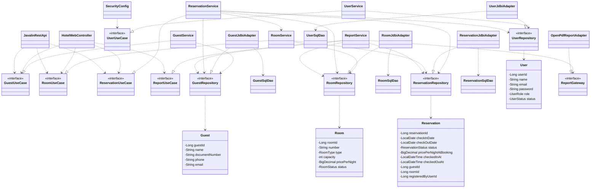

Se aplican los patrones Repository, Adapter e inyección de dependencias. Las entidades son records de Java con validaciones en sus constructores.

## 5. Modelo entidad-relación (base de datos)

Cada reserva pertenece a un huésped, una habitación y un usuario que la registra.

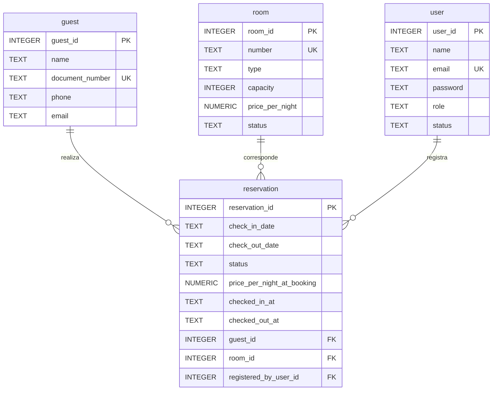

Las fechas se almacenan como TEXT. Los campos `checked_in_at` y `checked_out_at` admiten valores nulos. El esquema se encuentra en `src/main/resources/schema.sql`.

## 6. Endpoints o peticiones disponibles

### Interfaz web — Spring MVC y Thymeleaf (puerto 8080)

| Funcionalidad | Ruta | Método | Descripción |
|---|---|---|---|
| Inicio de sesión | `/login` | GET / POST | Mostrar formulario y autenticar |
| Cerrar sesión | `/logout` | POST | Finalizar sesión |
| Inicio y reservas | `/` o `/reservations` | GET | Listar reservas |
| Habitaciones | `/rooms` | GET | Listar y consultar disponibilidad (`checkIn`, `checkOut`) |
| Crear habitación | `/rooms/new` | POST | Registrar habitación (ADMIN) |
| Estado de habitación | `/rooms/{id}/status` | POST | Cambiar estado operativo (ADMIN) |
| Huéspedes | `/guests` | GET | Listar huéspedes |
| Crear huésped | `/guests/new` | POST | Registrar huésped |
| Crear reserva | `/reservations/new` | POST | Registrar reserva |
| Check-in | `/reservations/{id}/check-in` | POST | Registrar entrada |
| Check-out | `/reservations/{id}/check-out` | POST | Registrar salida |
| Cancelación | `/reservations/{id}/cancel` | POST | Cancelar reserva |
| Reporte de reservas | `/reports/reservations` | GET | PDF por `startDate` y `endDate` (ADMIN) |
| Comprobante | `/reports/receipt/{id}` | GET | Descargar comprobante PDF |

### API REST — Javalin (puerto 7070)

| Funcionalidad | Ruta | Método | Descripción |
|---|---|---|---|
| Habitaciones | `/api/rooms` | GET | Listar habitaciones en JSON |
| Disponibilidad | `/api/rooms/available` | GET | Consultar por `checkIn` y `checkOut` |
| Crear habitación | `/api/rooms` | POST | Registrar habitación |
| Estado de habitación | `/api/rooms/{id}/status` | PATCH | Actualizar estado |
| Huéspedes | `/api/guests` | GET | Listar huéspedes |
| Crear huésped | `/api/guests` | POST | Registrar huésped |
| Reservas | `/api/reservations` | GET | Listar reservas |
| Crear reserva | `/api/reservations` | POST | Registrar reserva |
| Check-in | `/api/reservations/{id}/check-in` | POST | Registrar entrada |
| Check-out | `/api/reservations/{id}/check-out` | POST | Registrar salida |
| Cancelación | `/api/reservations/{id}/cancel` | POST | Cancelar reserva |

### Ejemplo de petición en Postman

`POST http://localhost:7070/api/guests`  
Header: `Content-Type: application/json`

```json
{
  "name": "Mariana Torres",
  "documentNumber": "1000000003",
  "phone": "3000000000",
  "email": "mariana@example.com"
}
```

La API devuelve `201 Created` al registrar recursos, `204 No Content` en cambios de estado exitosos y maneja excepciones de negocio con códigos `400` y `409`.

## 7. Stack de tecnologías

| Tecnología o dependencia | Versión configurada | Uso |
|---|---|---|
| Java | 21 | Lenguaje principal |
| Gradle Wrapper | 9.6.0 | Automatización y compilación |
| Spring Boot / starters Web, Undertow, Thymeleaf, Security, DevTools y Test | 3.4.5 | Aplicación web, seguridad y pruebas |
| Spring Dependency Management | 1.1.7 | Gestión de dependencias |
| Thymeleaf Extras Spring Security 6 | 3.1.3.RELEASE | Integración de roles en vistas |
| Javalin | 6.1.3 | API REST |
| Jetty | 11.0.24 | Servidor de Javalin, versión configurada |
| Jackson Databind | 2.18.2 | Serialización JSON |
| Jackson Datatype JSR310 | 2.18.2 | Soporte para fechas Java |
| JDBI Core y SQL Object | 3.47.0 | Acceso a datos y DAO |
| SQLite JDBC | 3.47.1.0 | Driver de base de datos |
| OpenPDF | 2.0.3 | Generación de reportes PDF |
| JUnit Jupiter | 5 (gestionada por Spring Boot) | Pruebas unitarias |
| JUnit Platform Launcher | 1.11.4 | Ejecución de pruebas |
| HTML, CSS y JavaScript | — | Interfaz de usuario |

## 8. Capturas UI/UX

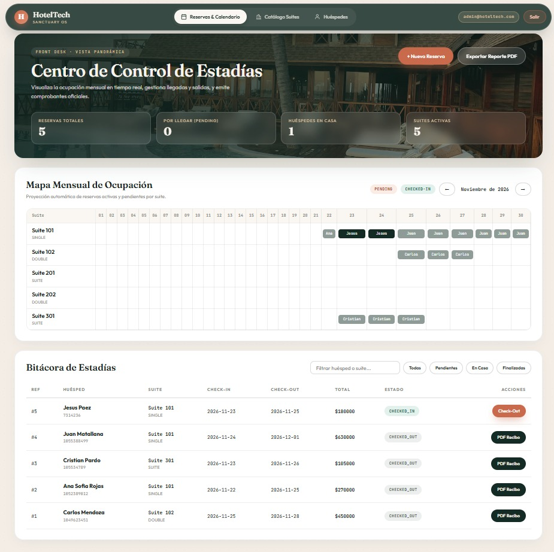

### Inicio de sesión

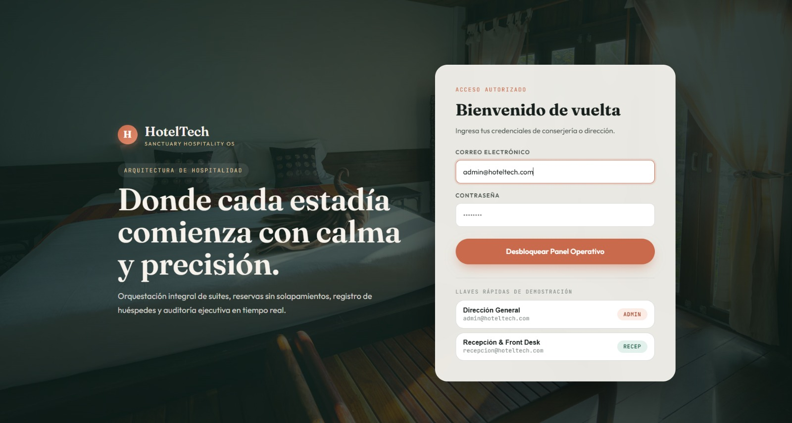

### Habitaciones

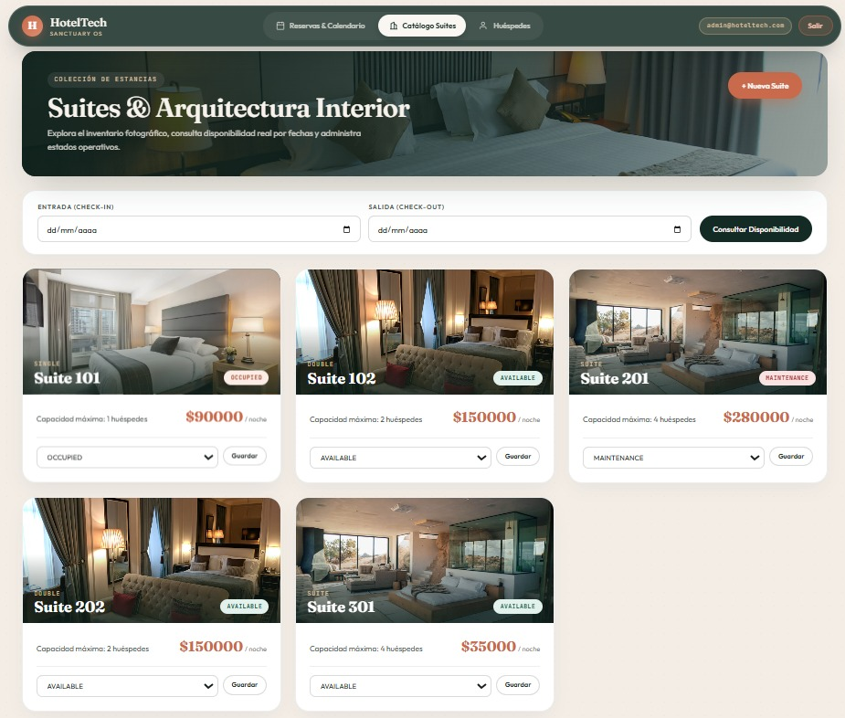

### Consulta de disponibilidad

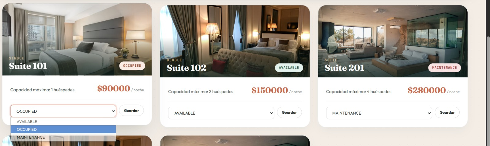

### Huéspedes

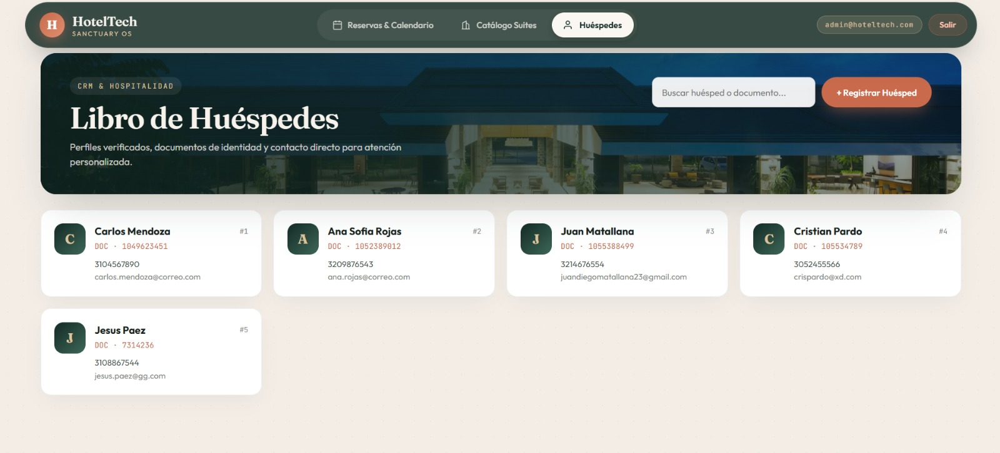

### Reservas
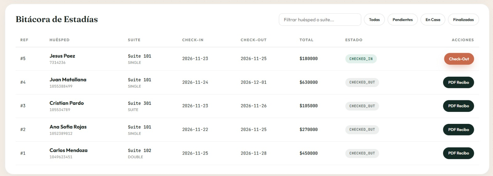

### Check-in y check-out


### Reporte de reservas PDF


### Comprobante PDF

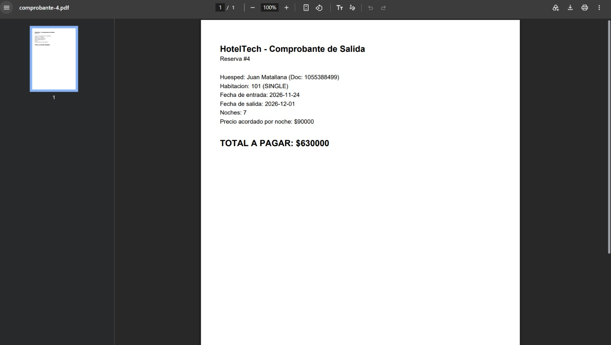

### Error 404

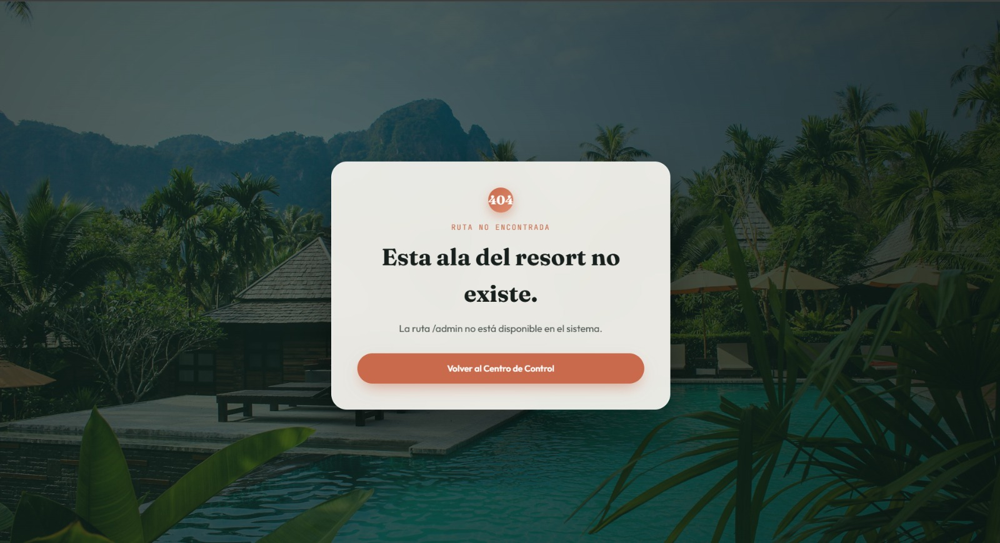

### Error 500

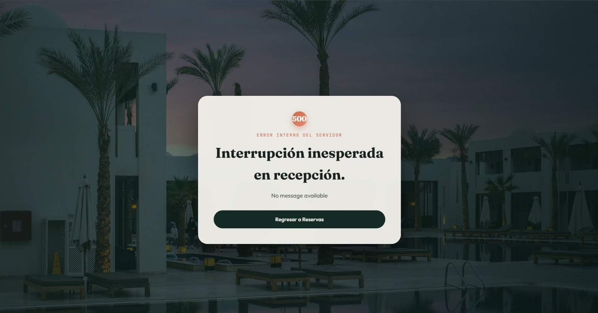

## 9. Análisis personal


Uno de los principales retos del desarrollo fue comprender cómo separar las responsabilidades de una aplicación mediante arquitectura hexagonal. Organizar las entidades, los servicios, los puertos y los adaptadores nos permitió entender que las reglas de negocio no deben depender directamente de las tecnologías utilizadas para presentar o almacenar la información.

Otro reto fue integrar Spring y Thymeleaf con Javalin, JDBI y SQLite dentro de un mismo proyecto. La gestión de reservas también representó un desafío debido a las validaciones de fechas, la disponibilidad de habitaciones y los cambios de estado que se presentan durante una estadía.

Entre los aprendizajes técnicos más valiosos destacamos la implementación de casos de uso mediante interfaces, el acceso a bases de datos con JDBI, la construcción de endpoints REST, el manejo de seguridad por roles y la generación de reportes PDF. Las pruebas unitarias nos permitieron comprender la importancia de verificar las reglas de negocio de forma independiente.

El aspecto más interesante del proyecto fue aplicar estos conocimientos a una problemática concreta del sector hotelero y construir una solución que integra diferentes tecnologías sin perder la separación de responsabilidades. Consideramos que lo aprendido durante la asignatura constituye una base útil para desarrollar aplicaciones mantenibles y adaptables a nuevas necesidades.
